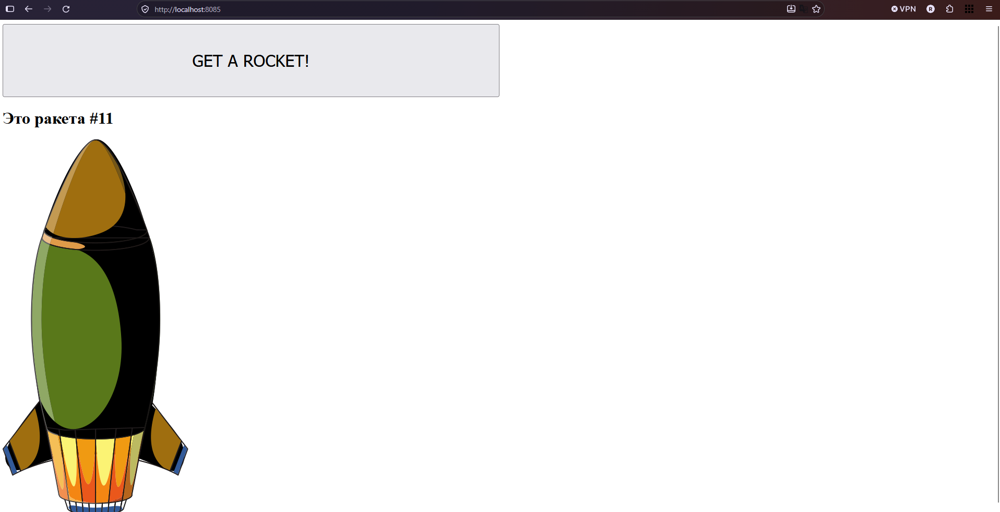
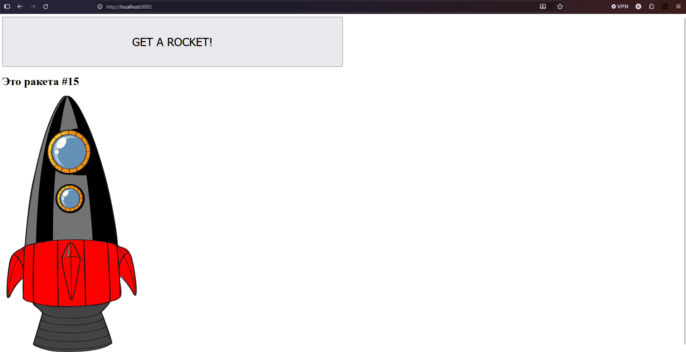
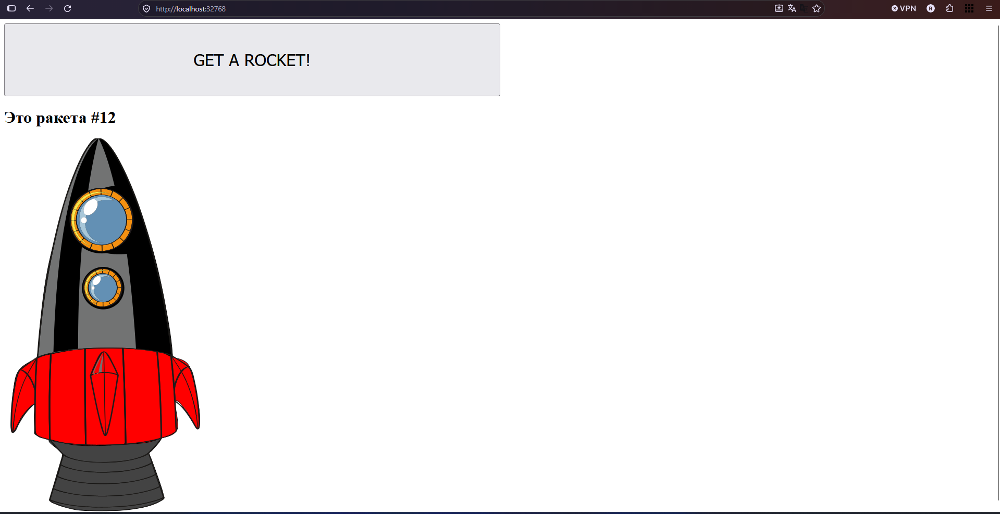
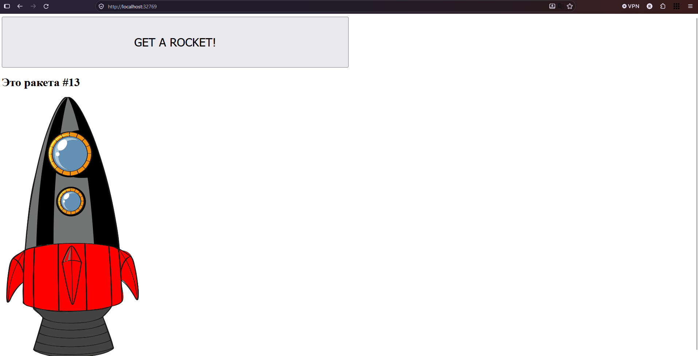

# Лабораторная работа №3 Моргун Д.Р. ПМ-41

Проект:

Отчет по лабораторной

docker-compose.yml, где описаны два сервиса: redis (хранит значение счётчика) и rocketcounter (показывает страницу с кнопкой GET A ROCKET)

Зависимости:  
Docker Desktop с Linux containers и Docker Compose. Git для клонирования репозитория

Команды запуска:

```
git clone https://github.com/Kentolf/Docker.git
cd Docker\lab3
docker compose up -d --scale rocketcounter=2
docker compose ps
```

Где:  
up -d - запускаем стек 
--scale rocketcounter=2 - запускаем две копии приложения с одним общим Redis
ps - смотрим контейнеры и опубликованные порты

Вывод docker compose ps:

```
NAME                   STATUS         PORTS
lab3-redis-1           Up 2 seconds   6379/tcp
lab3-rocketcounter-1   Up 1 second    0.0.0.0:32769->5000/tcp, [::]:32769->5000/tcp
lab3-rocketcounter-2   Up 2 seconds   0.0.0.0:32768->5000/tcp, [::]:32768->5000/tcp
```

Остановка и удаление:

```
docker compose down -v
```

Команда удаляет контейнеры и сеть проекта, а -v также удаляет его тома

# Отчет:

ОС: Windows 11
Docker Client: 29.8.0  
Docker Server: 29.8.0 (Engine)  
Docker Compose: v5.5.1

1) Через docker run запускаем Redis. Флаг -d запускает контейнер в фоне, --name redis задаёт имя, а последний redis - имя образа. А через docker ps проверяем контейнер (статус Up - работает)

```
PS C:\Users\dimam> docker run -d --name redis redis
70ea5904d09b6ea6628330f5fa8ae069810b2e2aedf741836df6c4221e42d338
```

Через docker ps проверяем контейнер (статус Up - работает)
```
PS C:\Users\dimam> docker ps --filter "name=redis"
CONTAINER ID   IMAGE     COMMAND                  CREATED         STATUS         PORTS      NAMES
70ea5904d09b   redis     "docker-entrypoint.s…"   2 minutes ago   Up 2 minutes   6379/tcp   redis
```

2) Запускаем приложение со счётчиком. Через --link redis:redis связываем его с Redis по имени redis (лекция 8, пункт 3). Флаг -p 8085:5000 связывает порт 8085 на компьютере с портом 5000 внутри контейнера приложения (лекция 10, пункт 3). 

```
PS C:\Users\dimam> docker run -d --name rocketcounter --link redis:redis -p 8085:5000 rotorocloud/rocket-counter
710208130ea318e64f2f457126faf4b69c40f7507c68ebd7b330d4ecaae17ce4
```

Проверяем, снова статус Up. 

```text
PS C:\Users\dimam> docker ps --filter "name=rocketcounter"
CONTAINER ID   IMAGE                        COMMAND       CREATED         STATUS         PORTS                                         NAMES
710208130ea3   rotorocloud/rocket-counter   "flask run"   2 minutes ago   Up 2 minutes   0.0.0.0:8085->5000/tcp, [::]:8085->5000/tcp   rocketcounter
```

 В браузере http://localhost:8085:
	

3) Останавливаем контейнеры через docker stop и удаляем через docker rm. Через docker ps -a смотрим все контейнеры

```
PS C:\Users\dimam> docker stop rocketcounter redis
rocketcounter
redis
PS C:\Users\dimam> docker rm rocketcounter redis
rocketcounter
redis
PS C:\Users\dimam> docker ps -a 
CONTAINER ID   IMAGE                                       COMMAND                  CREATED        STATUS                     PORTS                      NAMES
*тут мои контейнеры, rocketcounter и redis нет*
PS C:\Users\dimam>
```

4) Создаём каталог и переходим в него

```
New-Item -ItemType Directory -Force -Path "C:\Users\dimam\OneDrive\Desktop\Docker\lab3" | Out-Null
cd "C:\Users\dimam\OneDrive\Desktop\Docker\lab3"
```

В этой папке создаём файл docker-compose.yml. В services описываем Redis и приложение. В image указываем готовые образы, а в ports - публикацию порта приложения (лекция 8, пункты 4 и 5). Структура YAML задаётся отступами из пробелов. ports - список, его элементы начинаются с -, а значение 8085:5000 заключается в кавычки (лекция 8, пункты 2.2, 2.3 и 3).

```
services:
  redis:
    image: redis

  rocketcounter:
    image: rotorocloud/rocket-counter
    ports:
      - "8085:5000"
```

Compose сам создаёт общую сеть, приложение обращается к Redis по имени redis, то есть  
--link уже не нужен (лекция 8, пункт 6). Через docker compose config проверяем файл, ошибок нет.

```
PS C:\Users\dimam\OneDrive\Desktop\Docker\lab3> docker compose config
name: lab3
services:
  redis:
    image: redis
    networks:
      default: null
  rocketcounter:
    image: rotorocloud/rocket-counter
    networks:
      default: null
    ports:
      - mode: ingress
        target: 5000
        published: "8085"
        protocol: tcp
networks:
  default:
    name: lab3_default
```

5) Запускаем весь стек через docker compose up -d и проверяем контейнеры через `docker compose ps` (лекция 8, пункт 7).

```
PS C:\Users\dimam\OneDrive\Desktop\Docker\lab3> docker compose up -d
Network lab3_default           Created
Container lab3-rocketcounter-1 Started
Container lab3-redis-1         Started

PS C:\Users\dimam\OneDrive\Desktop\Docker\lab3> docker compose ps
NAME                   IMAGE                        COMMAND                  SERVICE         CREATED          STATUS          PORTS
lab3-redis-1           redis                        "docker-entrypoint.s…"   redis           32 seconds ago   Up 31 seconds   6379/tcp
lab3-rocketcounter-1   rotorocloud/rocket-counter   "flask run"              rocketcounter   32 seconds ago   Up 30 seconds   0.0.0.0:8085->5000/tcp, [::]:8085->5000/tcp
```

На http://localhost:8085: 


6) Один порт 8085 нельзя одновременно отдать двум контейнерам на одном IP-адресе компьютера, поэтому меняем 8085:5000 на 0:5000. Так Docker сам может выбрать свободный порт для каждой копии приложения. Внутри контейнеров порт остаётся 5000. В docker-compose.yml:

```yaml
services:
  redis:
    image: redis

  rocketcounter:
    image: rotorocloud/rocket-counter
    ports:
      - "0:5000"
```

Через --scale rocketcounter=2 задаём две копии приложения. Обе копии запускаются из одного образа. Три работающих контейнера - один Redis и два приложения. Первое доступно на http://localhost:32769, второе на http://localhost:32768

```text
PS C:\Users\dimam\OneDrive\Desktop\Docker\lab3> docker compose up -d --scale rocketcounter=2
Container lab3-rocketcounter-2 Started
Container lab3-redis-1         Started
Container lab3-rocketcounter-1 Started

PS C:\Users\dimam\OneDrive\Desktop\Docker\lab3> docker compose ps
NAME                   IMAGE                        COMMAND                  SERVICE         CREATED         STATUS         PORTS
lab3-redis-1           redis                        "docker-entrypoint.s…"   redis           6 seconds ago   Up 2 seconds   6379/tcp
lab3-rocketcounter-1   rotorocloud/rocket-counter   "flask run"              rocketcounter   6 seconds ago   Up 1 second    0.0.0.0:32769->5000/tcp, [::]:32769->5000/tcp
lab3-rocketcounter-2   rotorocloud/rocket-counter   "flask run"              rocketcounter   6 seconds ago   Up 2 seconds   0.0.0.0:32768->5000/tcp, [::]:32768->5000/tcp
```


На http://localhost:32769


На http://localhost:32768 тот же счетчик


На http://localhost:32769 все обновляется 


7. В конце через docker compose down -v удаляем стек (лекция 8, пункт 7)

```
PS C:\Users\dimam\OneDrive\Desktop\Docker\lab3> docker compose down -v
Container lab3-rocketcounter-1 Removed
Container lab3-rocketcounter-2 Removed
Container lab3-redis-1         Removed
Network lab3_default          Removed
```

Проверяем, что контейнеров и сети больше нет. Список сетей смотрим через 
docker network ls (лекция 10, пункт 8). Через фильтр по метке com.docker.compose.project=lab3 выбираем только ресурсы этой лабораторной.

```
PS C:\Users\dimam\OneDrive\Desktop\Docker\lab3> docker ps -a --filter "label=com.docker.compose.project=lab3" --format "{{.Names}}"
PS C:\Users\dimam\OneDrive\Desktop\Docker\lab3> docker network ls --filter "label=com.docker.compose.project=lab3" --format "{{.Name}}"
```

Обе проверки ничего не вывели, значит контейнеры и сеть удалены.

8. Повторный запуск из репозитория

```
git clone https://github.com/Kentolf/Docker.git
cd Docker\lab3
docker compose up -d --scale rocketcounter=2
docker compose ps
```

При повторном запуске порты могут быть другими, надо посмотреть их в docker compose ps. В репозитории оставлена финальная версия файла с "0:5000".

Вопросы

**1. Зачем в первой части использовался --link и почему в Compose он не нужен?**
--link redis:redis связывает контейнер приложения с Redis, чтобы приложение могло обращаться к нему по имени redis (устаревший способ). В Compose есть общая сеть и встроенный DNS, поэтому сервисы находят друг друга по именам без --link

**2. Чем отличается image от build?**
Через image указываем готовый образ, а через build описываем сборку образа из исходников и Dockerfile. Здесь используются готовые образы, поэтому достаточно image (лекция 8, пункты 5 и 8).

**3. Почему нельзя масштабировать сервис с фиксированным портом и как это обойти?**
Потому что нельзя одновременно занять один TCP-порт на одном IP-адресе двумя контейнерами. Но можно использовать динамические порты (как у нас) или назначить разные фиксированные порты. Ещё можно запускать копии на разных хостах или публиковать их порты на разных IP-адресах

**4. Что делает docker compose down -v и чем отличается от down без -v?**
down останавливает и удаляет контейнеры и сети проекта. С -v дополнительно удаляются именованные тома из Compose-файла и анонимные тома контейнеров. Без -v не удаляются 

**5. Как в Compose обеспечивается сетевое имя сервиса?**
Контейнеры подключаются к общей сети и находят сервисы по именам через встроенный DNS Docker. В нашем случае приложение обращается к redis:6379, поэтому знать IP-адрес контейнера Redis не нужно (лекция 10, пункты 6 и 7).
